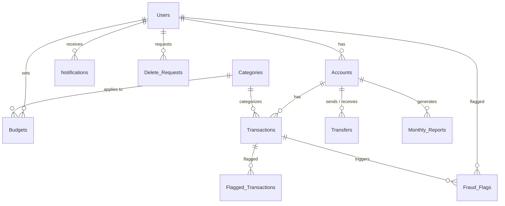

# FinTrace — Financial Audit System

FinTrace is a full-stack personal-finance and audit system built with **Flask (Python)**, **MySQL 8** and **Bootstrap 5**.

- **Users** manage an account, add income/expenses, transfer money, set monthly budgets, get alerts and see their credit score.
- **Admins** get a complete audit trail, flagged high-value transactions, fraud detection, monthly reports and user management.

Most of the business logic lives **inside MySQL**: triggers, stored procedures with cursors, functions, views, a scheduled event and ACID transactions.

---

## 🚀 How to run it on your computer (Windows)

### Step 0 — Install these once
| Software | Download | Notes |
|---|---|---|
| **MySQL Server 8.0 + MySQL Workbench** | <https://dev.mysql.com/downloads/installer/> | Choose *"Server only"* + *Workbench*, or *"Full"*. Remember the **root password** you set. |
| **Python 3.10 – 3.13** | <https://www.python.org/downloads/> | ✅ Tick **"Add Python to PATH"** on the first install screen. |

### Step 1 — Unzip
Unzip `fintrace_project.zip` somewhere simple, e.g. `C:\Projects\fintrace_project`.

### Step 2 — Create the database (MySQL Workbench)
1. Open **MySQL Workbench** → click your **Local instance** connection → enter your root password.
2. **File → Open SQL Script…** → select `database\schema.sql` → click the ⚡ **lightning bolt** (Execute).
   The Output panel at the bottom ends with green ticks and `FinTrace schema created`.
3. **File → Open SQL Script…** → select `database\seed.sql` → click ⚡ again.
   A grid shows the 5 demo users and their balances.
4. In the left **Schemas** panel click 🔄 **refresh** → expand **`fintrace`** → you'll see all **Tables, Views, Stored Procedures, Functions**
   (triggers are under each table, e.g. *Transactions → Triggers*; the event is under *Events*).

> ⚠️ `schema.sql` **deletes and recreates** the `fintrace` database. To keep an old one, first right-click it → *Data Export*.

### Step 3 — Set up the app (one time)
Double-click **`setup.bat`** in the project folder. It will:
1. create a Python virtual environment,
2. install the packages,
3. create `fintrace\.env` and open it in Notepad → change **`MYSQL_PASSWORD=`** to *your* MySQL root password → **save** and close.

### Step 4 — Start the app
Double-click **`run.bat`**. A black window opens (the server) and your browser opens **<http://localhost:5000>** 🎉
Keep the black window open while you use the app; close it to stop.

### Step 5 — Log in (password for every demo user: `password123`)
| Role | Email | What to show |
|---|---|---|
| **Admin** | `rahul@gmail.com` | Dashboard, Audit Log, Flagged (4), Fraud Detection (2), Reports, Delete Requests (1), credit scores |
| User | `priya@gmail.com` | Budget-exceeded alert (Groceries), received transfer |
| User | `arjun@gmail.com` | High-value + midnight transaction → **high** fraud flag |
| User | `sneha@gmail.com` | Low-balance warning (₹700 left), pending deletion request |
| User | `vikram@gmail.com` | Inactive for 45 days → **low** fraud flag |

Check the database connection any time: <http://localhost:5000/health>

<details>
<summary><b>Prefer typing commands instead of the .bat files?</b></summary>

```bat
cd fintrace
python -m venv venv
venv\Scripts\activate
pip install -r requirements.txt
copy .env.example .env
notepad .env
python app.py
```
Database from Command Prompt (if `mysql` is on your PATH):
```bat
mysql -u root -p < database\schema.sql
mysql -u root -p < database\seed.sql
```
</details>

### 🛠️ Troubleshooting
| Problem | Fix |
|---|---|
| `'python' is not recognized` | Reinstall Python and tick **Add Python to PATH**, then open a new window. |
| `pip install` fails on **mysqlclient** | Use Python **3.10–3.13** (3.14 may not have a ready-made Windows build yet). |
| `Access denied for user 'root'` | Wrong `MYSQL_PASSWORD` in `fintrace\.env`. |
| `Unknown database 'fintrace'` | Run `database\schema.sql` in Workbench (Step 2). |
| `Can't connect to MySQL server` | MySQL isn't running: open *Services* → start **MySQL80**. |
| Workbench: *Error 1175 safe update mode* | Already handled in `seed.sql`; make sure you ran the latest file. |
| Port 5000 busy | Change `FLASK_PORT=5001` in `fintrace\.env`. |

---

## 📂 Project structure
```
fintrace_project/
├── setup.bat               # one-time setup (venv + packages + .env)
├── run.bat                 # start the app and open the browser
├── README.md
├── .gitignore              # keeps .env and venv out of GitHub
├── database/
│   ├── schema.sql          # the WHOLE database: tables, views, triggers, procedures, functions, event
│   └── seed.sql            # demo users, categories, budgets, transactions
└── fintrace/
    ├── app.py              # Flask backend: page routes + REST API
    ├── database.py         # MySQL connection (reads .env)
    ├── requirements.txt    # Python packages
    ├── .env.example        # template for your .env
    ├── static/js/main.js   # shared frontend helpers
    └── templates/          # 14 pages (Jinja + Bootstrap 5)
        ├── layout.html             # sidebar + shared layout
        ├── login.html, register.html
        ├── user_dashboard.html     # balance, income, expense, credit score, add transaction
        ├── my_transactions.html, transfers.html, budget.html, notifications.html
        ├── admin_dashboard.html    # system stats, users (with credit score), all transactions
        ├── audit.html, flagged.html, fraud_flags.html, reports.html, delete_requests.html
```

---

## 🧩 How the pieces connect
```
Browser (HTML + JS)  ──fetch /api/...──▶  Flask app.py  ──SQL / CALL──▶  MySQL 8
                                             │                          ├─ procedures (TransferFunds, AddTransaction, …)
                                             │                          ├─ triggers fire automatically on every change
                                             └─ session login,          ├─ functions (credit score, totals, spending)
                                                role + ownership checks └─ daily event (inactive-user scan)
```
Example — a user adds a ₹60,000 expense:
1. `user_dashboard.html` → `POST /api/add-transaction`
2. `app.py` checks the user owns the account → `CALL AddTransaction(...)`
3. The procedure locks the account row, checks the balance, inserts the transaction, updates the balance, commits.
4. Triggers fire: **audit log** entry · **flagged** (> ₹50,000) · **fraud** check · **budget** check · **low-balance** check.
5. The admin sees it immediately in Audit Log and Flagged Transactions.

---

## 🗄️ Database (MySQL 8)

**12 tables · 3 views · 6 triggers · 6 stored procedures · 3 functions · 1 scheduled event**



| Table | Purpose |
|---|---|
| `Users` | admins and users (hashed passwords, last login) |
| `Accounts` | one account per user; `CHECK (balance >= 0)` |
| `Categories` | income / expense categories |
| `Transactions` | every money movement; `CHECK (amount > 0)` |
| `Transfers` | ACID transfers between accounts |
| `Audit_Log` | filled **only by triggers**: every insert / update / delete |
| `Notifications` | low balance, budget exceeded, transfers, high-value alerts |
| `Budgets` | monthly limit per user per category (unique) |
| `Monthly_Reports` | income / expense / savings per account per month (unique) |
| `Flagged_Transactions` | transactions over ₹50,000 |
| `Fraud_Flags` | suspicious activity with severity low / medium / high |
| `Delete_Requests` | a user asks the admin to delete their account |

### Triggers (6)
| Trigger | When | What it does |
|---|---|---|
| `trg_audit_transaction_insert` / `_update` / `_delete` | any change to `Transactions` | writes before/after values to `Audit_Log` |
| `trg_transaction_checks` | new transaction | flag > ₹50,000 · fraud checks · budget-exceeded alert |
| `trg_low_balance_warning` | balance drops below ₹1,000 | notifies the user |
| `trg_audit_transfer_insert` | new transfer | writes to `Audit_Log` |

### 🛡️ Fraud detection
| Rule | Severity | Where it runs |
|---|---|---|
| Transaction over ₹50,000 between 12 AM and 4 AM | **high** | trigger `trg_transaction_checks` |
| 3+ transactions over ₹25,000 on one account within 1 hour | **medium** | trigger `trg_transaction_checks` |
| User with no login or transaction for 30+ days | **low** | procedure `DetectInactiveUsers`, run **daily** by event `evt_detect_inactive_users` and by the admin's **Run Inactive-User Scan** button |

Admins review flags on the **Fraud Detection** page. Each unreviewed flag lowers the user's credit score.

### Stored procedures (6)
| Procedure | Highlights |
|---|---|
| `TransferFunds` | **ACID**: `START TRANSACTION`, row locks (`FOR UPDATE`), `ROLLBACK` on any error, `COMMIT` on success |
| `AddTransaction` | validates, locks the row, inserts + updates the balance atomically |
| `GenerateMonthlyReport` | **cursor** over accounts; upserts one report per account |
| `GetAccountSummary` | **cursor** over an account's transactions |
| `SetBudget` | upsert (`ON DUPLICATE KEY UPDATE`) |
| `DetectInactiveUsers` | fraud rule 3 (inactive users) |

### Functions (3)
| Function | Returns |
|---|---|
| `CalculateTotalByType(account, 'credit'\|'debit')` | total income or expense of an account |
| `GetMonthlySpending(user, category)` | this month's spending in a category |
| `CalculateCreditScore(user)` | **300–900** score: savings ratio, balance, activity, minus fraud flags and low-balance alerts. Shown on the user dashboard and in the admin's user table. |

### Views (3)
`vw_transaction_report` · `vw_audit_report` · `vw_account_summary`

---

## 🔐 Security
- Passwords hashed with Werkzeug (scrypt); login gives one message for both unknown email and wrong password.
- Session login; admin pages and APIs need the `admin` role (users are redirected away).
- **Ownership checks**: users can only see and move **their own** money and data.
- Secrets (DB password, `SECRET_KEY`) live in `fintrace/.env`, which `.gitignore` keeps off GitHub.

---

## 🌐 API
| Area | Endpoints |
|---|---|
| Auth | `POST /api/login` · `POST /api/register` · `POST /api/logout` · `GET /api/session` |
| Dashboard | `GET /api/dashboard/<user_id>/<role>` |
| Transactions | `GET /api/transactions` · `GET /api/my-transactions/<account_id>` · `POST /api/add-transaction` · `DELETE /api/delete-transaction/<id>` (admin) |
| Transfers | `POST /api/transfer` · `GET /api/transfers/<account_id>` · `GET /api/accounts` · `GET /api/accounts/all` |
| Budgets | `POST /api/set-budget` · `GET /api/budgets/<user_id>` · `GET /api/categories` |
| Notifications | `GET /api/notifications/<user_id>` · `POST /api/mark-notification-read/<id>` |
| Fraud & flags | `GET /api/flagged-transactions` · `POST /api/review-flag/<id>` · `GET /api/fraud-flags` · `POST /api/review-fraud/<id>` · `POST /api/run-fraud-scan` |
| Admin | `GET /api/users` · `GET /api/admin/users-summary` · `DELETE /api/admin/delete-user/<id>` · `GET /api/audit-logs` · `GET /api/delete-requests` · `POST /api/handle-delete-request/<id>` · `POST /api/request-account-deletion` |
| Reports | `POST /api/generate-report` · `GET /api/monthly-reports` · `GET /api/download-report/<id>` (CSV) |
| Other | `GET /api/credit-score/<user_id>` · `GET /api/account-summary/<account_id>` · `GET /api/total/<account_id>/<type>` · `GET /health` |

---

## 🧪 Demo / test checklist
- [ ] Register a new user, then log in with it
- [ ] Add a credit and a debit: the balance changes by **exactly** that amount
- [ ] Transfer money: both balances change. Try more than your balance: clean error, nothing changes (rollback)
- [ ] Set a budget lower than what you've spent: "Budget exceeded" notification
- [ ] Spend until the balance is below ₹1,000: low-balance warning
- [ ] Add a transaction over ₹50,000: it appears in **Flagged Transactions**
- [ ] Add 3 transactions over ₹25,000 quickly: **medium** fraud flag
- [ ] Admin → Fraud Detection → **Run Inactive-User Scan**; review a flag and see the credit score go up
- [ ] Admin → Audit Log shows every change exactly once
- [ ] Admin → generate a monthly report twice: no duplicates; download the CSV
- [ ] Admin → approve or reject a deletion request; delete a user (cascade removes their data)
- [ ] As a normal user, open `/audit-page`: redirected to your own dashboard
- [ ] Show the same changes live in MySQL Workbench (`SELECT * FROM Audit_Log;`)
